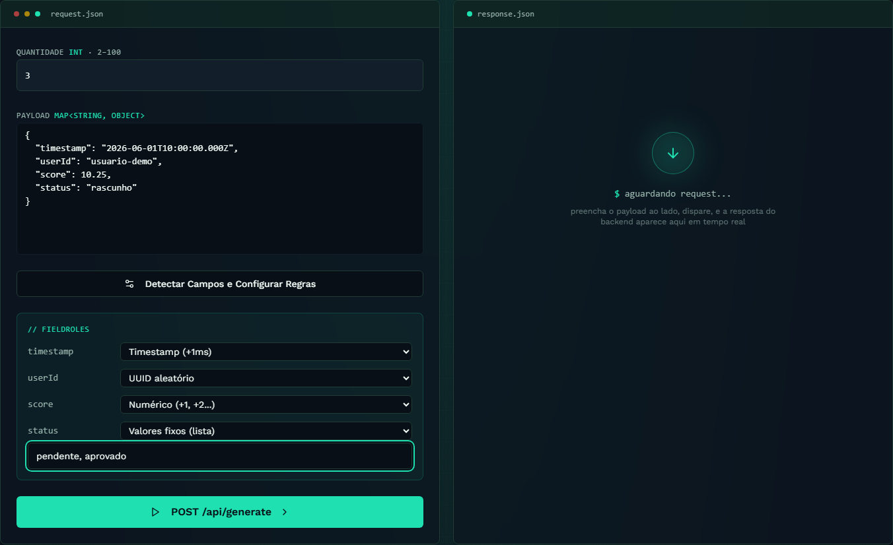
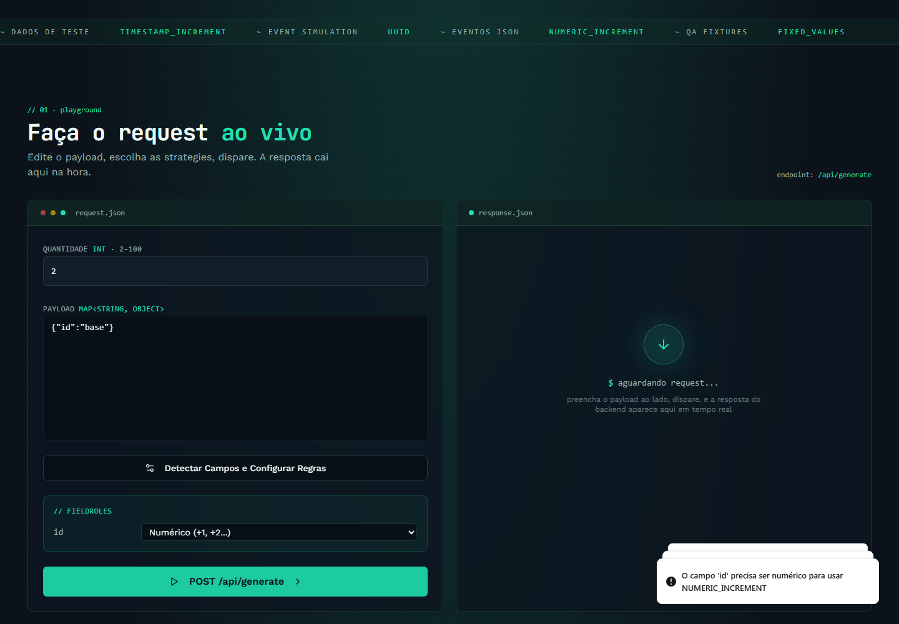
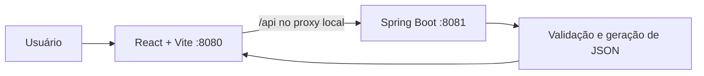

<div align="center">

# ClonePayloads · Frontend

**Transforme um JSON em dados de teste com regras por campo.**


[](https://github.com/ezequieldesr/ClonePayloads_Frontend/actions/workflows/ci.yml)

[Demonstração](#demonstração) · [Executar](#executar-localmente) · [Testes](#testes-e-gravação) · [API Java](https://github.com/ezequieldesr/ClonePayloads_Backend)

</div>

## O projeto

Ferramenta web para gerar de **2 a 100 variações de um payload JSON**, escolhendo uma estratégia por campo.
Ajuda a preparar exemplos de eventos, massas de dados e fixtures para testes de APIs.
O frontend React/TypeScript se conecta a uma API própria em Java 21 e Spring Boot 4.
**Não precisa de banco de dados.** Não executa testes de carga nem publica eventos no Kafka.

## Demonstração

[](docs/demo/clonepayloads-demo.mp4)

**[▶ Vídeo em PT-BR: da entrada ao JSON gerado](docs/demo/clonepayloads-demo.mp4)** ·
[Versão WebM](docs/demo/clonepayloads-demo.webm) · [Roteiro](docs/ROTEIRO-DEMONSTRACAO.md)

Gravado por Playwright contra a API real local, sem respostas simuladas. Vídeo sem narração, com legendas de etapas.
Os arquivos ficam disponíveis no GitHub após enviar os anexos deste repositório.

<details>
<summary><strong>📷 Abrir galeria</strong></summary>





</details>

## Funcionalidades

| Recurso | Comportamento |
| --- | --- |
| Entrada JSON | Objeto não vazio, até 100 campos de primeiro nível |
| Detecção | Lista campos e sugere incremento para timestamp |
| TIMESTAMP_INCREMENT | Soma +1ms, +2ms, +3ms… a uma string ISO-8601 |
| NUMERIC_INCREMENT | Soma +1, +2, +3… preservando decimais |
| UUID | Cria um UUID diferente por cópia em campo String |
| FIXED_VALUES | Alterna circularmente os valores de uma lista |
| Não modificar | Preserva o valor original do campo |
| Resultado | Array real da API, formatado e copiável |
| Validação | Erros de JSON, quantidade, regra, tipos e listas vazias |
| Disponibilidade | Consulta GET /api/health; não é um indicador estático |

Editar o JSON invalida as regras detectadas para evitar aplicar configurações de uma entrada anterior.
A API também impõe os limites: o frontend não é a única barreira de validação.

## Arquitetura



Não há login, banco, carrinho nem persistência de payloads. São recursos que não se aplicam a esta ferramenta.
A resposta permanece na aba; não utilize informações confidenciais ou dados reais de clientes.

## Executar localmente

Requisitos: **Node.js 24**, npm, **Java 21** e Maven 3.9+ ou o wrapper incluído no backend.

```bash
git clone https://github.com/ezequieldesr/ClonePayloads_Backend.git
git clone https://github.com/ezequieldesr/ClonePayloads_Frontend.git
```

**Terminal 1 — backend:**

```bash
cd ClonePayloads_Backend
mvn spring-boot:run
```

A API usa 8081 por padrão. Se houver `.env` ou variáveis de ambiente existentes, confira se `PORT=8081`.
Não é preciso criar um banco. Consulte o [README da API](https://github.com/ezequieldesr/ClonePayloads_Backend).

**Terminal 2 — frontend:**

```bash
cd ClonePayloads_Frontend
npm ci
```

Copie `.env.example` para **`.env.local`**. No PowerShell:

```powershell
Copy-Item .env.example .env.local
```

No Linux/macOS: `cp .env.example .env.local`.

```dotenv
VITE_API_URL=/
API_PROXY_TARGET=http://127.0.0.1:8081
```

```bash
npm run dev
```

Abra **http://127.0.0.1:8080**. `strictPort` impede trocar de porta silenciosamente.
O Vite encaminha `/api` ao backend em desenvolvimento e preview. `.env.local` tem precedência sobre `.env`;
reinicie o Vite após alterar configurações. **VITE_* é público no bundle: nunca coloque segredos nessas variáveis.**

<details>
<summary><strong>Usar diretamente uma API hospedada</strong></summary>

Defina `VITE_API_URL=https://seu-backend` antes de gerar o build. Não inclua `/api` no final.
Configure `CORS_ALLOWED_ORIGINS` no backend com a origem exata do frontend.
O proxy local usa `API_PROXY_TARGET`; um site estático publicado não executa o servidor Vite.

Para a Vercel, `vercel.json` encaminha `/api/*` ao endereço já utilizado pelo projeto,
`https://clonepayloads.onrender.com`, e fornece fallback da SPA.
Mantenha `VITE_API_URL=/` para usar esse proxy. Se mudar o backend, altere o destino do rewrite.
Envie primeiro o backend atualizado: ele precisa disponibilizar `/api/health` e o contrato documentado.

</details>

## Testes e gravação

```bash
npm run lint
npm run typecheck
npm run build
npm audit --audit-level high
npx playwright install chromium
```

Com a API ligada, execute `npm run preview` em um terminal. Em outro:

```bash
npm run test:e2e
npm run demo:record
npm run test:e2e:report
```

Quatro cenários cobrem a jornada das quatro estratégias e cópia, validações na interface,
limites da API e uso em celular 390×844. [Evidência resumida](docs/demo/verification.json).
Os testes não usam a API pública; confira suas variáveis antes de executá-los.

Para gerar MP4 e GIF com FFmpeg instalado: `npm run demo:export`.
`FFMPEG_PATH` pode apontar para o executável. O Playwright gera WebM sem instalação separada de FFmpeg.
Traces e relatórios podem conter os dados testados e ficam fora do Git.

## Integração contínua

CI executa lint, TypeScript, build e auditoria npm; outro workflow inicia a API e executa Playwright.
CodeQL e Dependency Review complementam a análise; Dependabot propõe atualizações semanais.
Actions fixadas por SHA e sem deploy automático. [Checks e limites de segurança](docs/CI-SEGURANCA.md).
O teste integrado usa a main pública do backend, não um PR ainda não integrado.

## Estrutura

```text
src/pages/Index.tsx       Playground e integração com a API
src/components/          Interface e explicação das estratégias
e2e/                     Testes reais com navegador e API
scripts/                 Gravação e exportação
docs/demo/               Vídeo, capturas e evidência resumida
vite.config.ts           Proxy local e configuração do Vite
.github/workflows/       CI, E2E, CodeQL e Dependency Review
```

Projeto desenvolvido entre junho e julho de 2026, com preparação de testes, documentação e demonstração em outubro de 2026.
[Autor: Ezequiel](https://github.com/ezequieldesr).
